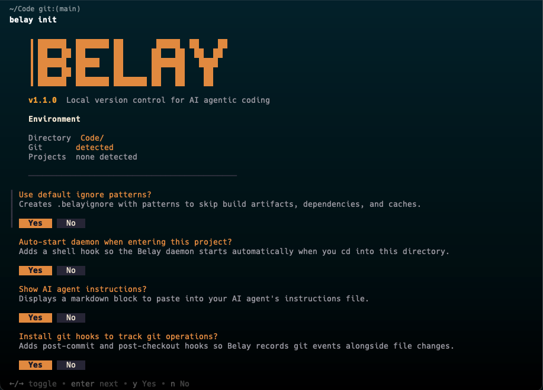

# Belay

[](https://go.dev/)
[](LICENSE)
[](https://github.com/davidparkercodes/belay/releases)
[](https://github.com/davidparkercodes/belay/releases)
[](https://github.com/davidparkercodes/belay/releases)
[](https://github.com/davidparkercodes/belay/releases)

**Never lose code to an AI session again.**

Belay tracks every file change between git commits, attributes each change to the AI session that made it, and gives you a complete, recoverable history. Install it once, forget about it. When something goes wrong, recover any file in under a second.

Free, local, and open source.

## Why Belay?

AI agents move fast. A working codebase can break in a few prompts, and if you didn't commit, that version is gone. Run multiple agents in parallel and they silently overwrite each other's work. Git can't help -- it doesn't know about AI sessions.

Belay watches your filesystem, records every change, and tags each one to the AI session that made it. When two agents edit the same file, Belay catches it. When an agent destroys your work, Belay recovers it. Your AI agents can also use Belay directly to check what changed, detect conflicts, and restore files.

## Install

**Install script (macOS and Linux)**
```bash
curl -fsSL https://raw.githubusercontent.com/davidparkercodes/belay/main/install.sh | sh
```
It downloads the latest release for your OS and architecture, verifies it against the release's `checksums.txt`, and installs it to `~/.local/bin` (set `BELAY_INSTALL_DIR` to change that, or `BELAY_VERSION=v1.2.3` to pin a version). It never uses `sudo`, and prints a PATH hint if the directory is not on your PATH.

**Homebrew (macOS)**
```bash
brew install davidparkercodes/tap/belay
```

**Go Install (any platform with Go 1.24+)**
```bash
go install github.com/davidparkercodes/belay/cmd/belay@latest
```

**Pre-built Binaries** -- Download from the [Releases page](https://github.com/davidparkercodes/belay/releases).

**Build from Source**
```bash
git clone https://github.com/davidparkercodes/belay.git
cd belay && go build -o bin/belay ./cmd/belay
```

Belay is a single static binary with zero runtime dependencies.

### Updating

```bash
belay update            # install the latest release the way this copy was installed
belay update --check    # only report whether a newer release exists
belay update --version v1.2.3
```

`belay update` detects how Belay was installed. A Homebrew install runs `brew upgrade --cask davidparkercodes/tap/belay`, a `go install` copy runs `go install` again, and a release binary (install script or Releases page) is downloaded, verified against `checksums.txt` and swapped in place, keeping the old binary as `belay.prev`. Development builds are left alone. Running daemons notice the new binary and restart into it once they are idle, keeping the same PID, so service units keep working. This also happens after a plain `brew upgrade`.

Updates are a per-user setting in `<user config dir>/belay/config.toml`:

| Mode | What happens |
|------|--------------|
| `notify` (default) | A daemon checks for a new release at most once a day in the background, and `belay status` shows one line when one is available |
| `auto` | The daemon also installs the new release itself (Homebrew installs run brew; release binaries are verified and swapped) |
| `off` | No checks |

Set it with `belay update --mode notify|auto|off` or `belay update --auto on|off`. `BELAY_NO_UPDATE_CHECK=1` turns off every background check and the status line. Hooks, `belay record` and `belay checkpoint` never touch the network.

> **Windows note:** Belay builds and runs on Windows but has not been tested in real-world use. macOS and Linux are the primary platforms. If you're a Windows user and want to help, we'd love testers. [Open an issue](https://github.com/davidparkercodes/belay/issues) with your experience.

## Quick Start

```bash
belay init
```

<p align="center">
  
</p>

That's it. Belay is now capturing every file change. Go back to work.

## Features

- **Continuous Capture** -- Runs silently in the background. Every file change is saved the instant it happens. No commits, no staging, no action needed.
- **Session Attribution** -- Every change is tagged to the session that made it. Claude Code, Cursor, Copilot, or your own saves. Belay tracks who changed what, when, and in what order.
- **Instant Recovery** -- One command to restore any file to any previous state. Browse history by time or by session and get back what you lost.
- **Conflict Detection** -- Alerts when multiple sessions edit the same file. Untangle overlapping work between agents with a full attribution trail.
- **Zero Intrusion** -- Never modifies your tools or slows them down. Watches the filesystem quietly, but when something goes wrong, your AI agent can use Belay directly.
- **Fully Local** -- All data stays on your machine. No cloud accounts, no sign-ups. A single init command creates your config and starts watching.
- **Encrypted at Rest** -- Every stored file version is encrypted with a per-user key kept in your OS keychain (or a `0600` key file). Losing the key loses the history: back it up with `belay key export`.

## How It Works

Belay uses kernel-level filesystem notifications (FSEvents on macOS, fsnotify on Linux/Windows) to watch your project. Every file write is compressed, encrypted (XChaCha20-Poly1305) and stored in a content-addressable object store keyed by an HMAC-SHA256 content id, so the index cannot be used to confirm a guessed secret. An append-only event log and SQLite index make queries fast across thousands of events.

Session attribution works automatically via process-tree heuristics, or with exact precision through hook-based integration with AI tools like Claude Code.

## AI Tool Integration

### Claude Code

Belay attributes changes to sessions automatically via process-tree heuristics, but adding the hook gives exact attribution. It fires after every file write, telling Belay precisely which session made the change.

Add the hook to your Claude Code settings (`~/.claude/settings.json`):

```json
{
  "hooks": {
    "PostToolUse": [
      {
        "matcher": "Write|Edit|NotebookEdit",
        "hooks": [
          {
            "type": "command",
            "command": "/path/to/belay/hooks/belay-hook.sh"
          }
        ]
      }
    ]
  }
}
```

The hook reads tool use JSON from stdin, extracts the file path and session ID, and calls `belay record` in the background. Non-blocking, will not slow down your AI tool. Without hooks, Belay still captures all changes via filesystem watching and uses process-tree heuristics to attribute sessions.

Writes the agent makes through a shell (`cat > file`, `sed -i`, build scripts) never pass through an editing tool, so no `record` call carries their session id; the watcher attributes them to the agent *process* instead (a session named like `claude-pid-1234`). Every `record` and `checkpoint` call now also tells the daemon which agent process it came from, and the daemon links that process session to the tool's session id. From then on the watcher attributes that process's writes to the tool session id directly, and `belay log --session`, `belay diff --session`, `belay restore --session` and `belay project --session` also include the events recorded under the process id before the link was made. To get the link as early as possible, run the same hook on `SessionStart` too (it only links there, it records nothing):

```json
{
  "hooks": {
    "SessionStart": [
      { "hooks": [ { "type": "command", "command": "/path/to/belay/hooks/belay-hook.sh" } ] }
    ]
  }
}
```

Any tool can do the same with `belay sessions link <session-id>` (the agent PID is found by walking up from the calling process, or pass `--pid`) or `POST /api/sessions/link`.

#### Pre-bash safety net (catches what `/rewind` misses)

Native Claude Code `/rewind` only rolls back edits made through the `Write`, `Edit`, and `NotebookEdit` tools. It does not see destructive bash: `rm -rf`, `git reset --hard`, `git clean`, `dropdb`, build scripts that overwrite files, or one-shot shell commands. Belay's `PreToolUse` Bash hook records a labeled checkpoint before every Bash invocation so you can roll back even those.

Add this hook alongside the PostToolUse one above:

```json
{
  "hooks": {
    "PreToolUse": [
      {
        "matcher": "Bash",
        "hooks": [
          {
            "type": "command",
            "command": "/path/to/belay/hooks/belay-pre-bash.sh"
          }
        ]
      }
    ]
  }
}
```

The hook never blocks Claude Code: it runs the checkpoint in the background with a 2-second watchdog and exits 0 even on failure. If a destructive command takes out a file, roll back with:

```bash
belay checkpoints                              # find the checkpoint label or id
belay restore --to-checkpoint <id-or-label> --all --execute
```

You can also create checkpoints manually outside Claude Code:

```bash
belay checkpoint --label "before refactor" --reason "about to move 30 files"
```

### Any Tool

For AI tools that don't support hooks, or custom integrations, push change events directly via the REST API:

```bash
curl -X POST "http://127.0.0.1:$(cat .belay/daemon.port)/api/record" \
  -H "Content-Type: application/json" \
  -H "X-Belay-Project: $(pwd -P)" \
  -d '{"file_path": "src/main.go", "operation": "modify", "tool_name": "my-tool", "session_id": "abc123"}'
```

Or let the CLI find the right daemon for you: `belay record <path> --session <id> --tool <name>`. It accepts absolute paths or paths relative to the current directory, records into the project that contains the file, and if the daemon is down it queues the event in `.belay/spool/` and starts the daemon (set `BELAY_NO_AUTOSTART=1` to disable).

### Git projection

`belay project` turns Belay history into git history without ever touching your working tree, index or HEAD: it builds one commit per session from the session's net changes (plus, by default, a reconcile snapshot of the working tree) and appends it to `refs/heads/belay-history` through git plumbing. Pair it with a `Stop` hook and git becomes an automatic, write-only projection of what your agents did.

```bash
belay project --session <id> --push origin          # sync with origin, project, push (retries if rejected)
belay project --session <id> --push origin --queue  # hand it to the daemon and return immediately
belay project --working-tree --push origin          # reconcile only (no session attribution needed)
belay project --status                              # the daemon's queue and recent results
```

With `--push`, the remote is the source of truth. Before projecting, the local ref is fast-forwarded to the remote's copy, and if the two diverged (another machine projected onto the same ref) the local-only projection commits are replayed on top of the remote tip, keeping their trees, messages, authors and dates. A push that is still rejected re-syncs and retries. With `--queue`, the running daemon executes jobs one at a time on a background queue, coalescing identical pending jobs, so any number of hooks can hand off work without serializing on a lock; if the daemon is unavailable the job runs inline instead. Defaults for the remote, ref and reconcile come from `[projection]` in `.belay/config.toml`.

#### Secrets are held back

Before writing the tree, every projection (session, working-tree reconcile, and the daemon queue) scans the net content of each changed file. A file that looks like it holds a credential is left out of that commit: a new file is not added, a modified file stays at its previously projected version, and deletions still project. The commit still happens, and when the secret is gone the next projection includes the file again. One line goes to stderr, and `--json` output and `belay project --status` carry a `held_back` list of paths and rule names (never the secret):

```
belay: held back 2 file(s) with likely credentials: config/prod.yml, notes.md (allow with .belayallow)
```

To allow something, add a `.belayallow` file at the project root. Path lines use gitignore syntax, and `rule:<name>` lines switch a detector rule off for the project (unknown rule names are reported and ignored):

```
test/fixtures/
docs/examples/*.env
rule:jwt
```

`belay project --allow-secrets` projects everything for one run (it is passed through `--queue` to the daemon), and `[projection] hold_back_secrets = false` turns the check off. Binary files and files over 8 MiB are not scanned. If the detector fails on a file, the file is projected as before and a warning is printed, so the check can never stall projection. Held-back content may still exist as an unreferenced object in the local `.git` until git garbage-collects it; it is never part of a commit or a push.

If several machines share one checkout but have different working trees, give each its own ref (for example `ref = "refs/heads/belay-history/<machine>"`) so their reconcile snapshots do not undo each other.

## CLI Reference

| Command | Description |
|---------|-------------|
| `belay init` | Initialize `.belay/` in the current directory |
| `belay remove` | Remove Belay from the current directory (opposite of init) |
| `belay daemon start` | Start the background watcher daemon |
| `belay daemon stop` | Stop the daemon |
| `belay service install` | Run the daemon under launchd (macOS) or systemd (Linux) so it survives reboots |
| `belay status` | System, daemon and API overview |
| `belay status --scan <dir>` | Health-check every Belay project under a directory (exits 1 if any is down) |
| `belay log` | Browse event history with filters |
| `belay grep` | Find events that added or removed a string (pickaxe, like `git log -S`) |
| `belay diff` | View changes between time points or sessions |
| `belay restore` | Recover files by time, event, or session |
| `belay sessions` | List and inspect AI sessions |
| `belay sessions link` | Tie the calling agent process to its tool session id (used by hooks) |
| `belay replay` | Replay a session's changes as diffs or patches |
| `belay conflicts` | Detect overlapping modifications across sessions |
| `belay commit` | Generate a git commit from a session |
| `belay project` | Project a session onto a git ref via plumbing (no working-tree mutation; concurrency-safe). `--push <remote>` syncs with the remote first and retries a rejected push; `--queue` hands the job to the daemon; `--status` shows the daemon's queue |
| `belay snapshot` | Reconstruct project state at any point in time |
| `belay checkpoint` | Mark a labeled, restorable point in time (pairs with `restore --to-checkpoint`) |
| `belay checkpoints` | List recorded checkpoints |
| `belay gc` | Garbage collection and storage compaction |
| `belay key status` | Where the store key lives, its id, and the store's encryption and migration progress |
| `belay key export` / `import` | Back up the store key, or install it on another machine (`--force` replaces a different key) |
| `belay key migrate` | Encrypt a legacy store now (the daemon otherwise does it in the background) |
| `belay update` | Update to the latest release (`--check`, `--version`, `--yes`, `--json`, `--mode notify\|auto\|off`, `--auto on\|off`) |
| `belay scrub` | Redact credentials from idle AI agent session logs (`--dry-run`, `--json`, `--undo <log>`, `--all-idle`) |

## API Endpoints

Each project's daemon serves its own API. It binds `[api] port` (default 33412) and, if that port is already taken by another project's daemon or any other program, falls back to a free port. The bound port is written to `.belay/daemon.port`; clients should read it rather than assume 33412.

Requests may send `X-Belay-Project: <absolute project root>`. A daemon that serves a different project answers `409` with `"code": "project_mismatch"` instead of recording the event in the wrong history. The CLI, Claude Code hooks and git hooks always send it.

| Method | Path | Description |
|--------|------|-------------|
| GET | `/api/health` | Health check |
| GET | `/api/stats` | Aggregate statistics |
| GET | `/api/events` | Query events (since, until, file, session, limit) |
| GET | `/api/sessions` | List sessions |
| GET | `/api/sessions/:id` | Session details and events |
| GET | `/api/files/history` | File change history |
| GET | `/api/files/content` | Get file content by hash |
| GET | `/api/conflicts` | Detect conflicts |
| POST | `/api/record` | Push file event from hook |
| POST | `/api/checkpoint` | Record a labeled checkpoint marker |
| GET | `/api/checkpoints` | List recorded checkpoints |
| POST | `/api/sessions/link` | Link an agent process (`pid`) to its tool `session_id` |
| POST | `/api/project` | Queue a projection job (`session_id`, `working_tree`, `remote`, `ref`) on the daemon |
| GET | `/api/project/status` | Projector queue, running job and recent results |
| GET | `/api/stream` | SSE real-time event stream |

## Configuration

Belay stores data in `.belay/` at the project root. Configuration is optional via `.belay/config.toml`:

```toml
[daemon]
log_level = "info"

[watcher]
debounce_ms = 50
max_file_size_mb = 50

[storage]
compression_enabled = true

[store]
encryption = true     # encrypt stored objects (turning it off later does not decrypt old ones)

[retention]
hot_hours = 24        # full fidelity
warm_days = 7         # hourly granularity (last modify per file/session/hour)
cold_days = 14        # session boundaries only
archive_days = 14     # daily snapshots (0 = forever)
max_storage_gb = 3
compaction_interval_min = 60   # daemon runs compaction hourly + shortly after startup
max_versions_per_file = 25     # cap MODIFY versions per file beyond hot (0 = unlimited)
compact_segments = true        # rewrite sealed event-log segments so purged events leave disk

[api]
port = 33412          # preferred port; falls back to a free one if taken (see .belay/daemon.port)
host = "127.0.0.1"

[projection]
remote = ""                       # remote that `belay project` syncs with and pushes to ("" = local ref only)
ref = "refs/heads/belay-history"  # ref that receives projection commits
base_ref = "HEAD"                 # ref the projection branch is bootstrapped from
working_tree = true               # follow each session projection with a working-tree reconcile snapshot
hold_back_secrets = true          # leave files with likely credentials out of projection commits

[safety]
allow_writes = false  # dry-run mode until you're ready

[scrub]
mode = "notice"       # agent logs: "off", "notice" (one line in belay status) or "auto" (daemon redacts idle logs)
```

All settings have sensible defaults. `belay init` generates a config with defaults. `safety.allow_writes` defaults to false so destructive commands (restore, replay, commit) show what they'd do without writing. Set to `true` once you trust the setup.

## Encryption at rest

Belay encrypts every object it stores, not only files that look sensitive. One 32-byte key per user is shared by all your Belay projects. It lives in the macOS Keychain or the Linux Secret Service (through the `security` and `secret-tool` CLIs) and falls back silently to `<user config dir>/belay/store.key` (mode `0600`) when no keychain is available. `BELAY_KEY_FILE` points Belay at a specific key file and skips the keychain.

**Losing the key loses the history.** There is no recovery. Back it up with `belay key export --out FILE` and restore it on a new machine with `belay key import FILE`.

Stores created before encryption are migrated in place by the daemon, in the background and resumably. Old objects stay readable during the migration, and no unencrypted object is deleted until its encrypted copy has been read back and compared byte for byte. `belay key status` and `belay status` show progress.

Encryption protects copies of `.belay/` that leave your session: backups, cloud sync, copied or stolen disks, and other tools that scan plain text on disk. It does not protect against malware or anyone running as your user, who can read the keychain or key file, and the local API still serves decrypted content to local callers.

## Agent log scrub

Agent session logs (Claude Code transcripts today) keep a plain-text copy of anything pasted into a chat: API keys, tokens, an app password typed into a sentence. Those logs belong to the agent, not to Belay, so Belay only offers to clean them up.

```bash
belay scrub --dry-run          # which logs have findings, counts per rule, nothing changed
belay scrub                    # redact every idle log for this project
belay scrub --undo <log>       # put the original back, byte-exact
belay scrub --all-idle         # also idle logs of the agent's other projects
```

- Only idle logs are touched: no write in the last 30 minutes and not an active Belay session, because agents read their own logs to resume.
- Each finding becomes `[redacted:<rule>]`. JSONL lines are redacted inside their JSON string values and only those strings are re-encoded, so every line stays valid JSON; other lines are redacted as text. Output shows counts per rule, never the secret.
- Before a log is rewritten, its original bytes go into Belay's encrypted store (kept from garbage collection) and a record goes to `.belay/scrub/backups.jsonl`. `--undo` restores them byte-exact; lines the agent appended after the scrub are kept after the original. The rewrite goes through a temp file and rename, keeps the file mode and modification time, and is abandoned if the log changes while it runs.
- Scrub needs store encryption on, since it would otherwise keep the originals in plain text.

`[scrub] mode` decides what happens without you asking:

- `notice` (default): `belay status` shows one line when this project's logs hold findings, for example `3 credentials in plain text in agent logs. Run belay scrub to redact.` Counts are cached by log path, size and modification time, and status never spends more than a fraction of a second scanning; it shows nothing rather than wait.
- `auto`: the daemon redacts idle logs every 15 minutes, with a cap on how much it reads per round, and never redoes a scrub you undid. `belay status` stays silent unless a round failed.
- `off`: nothing.

`belay init` asks one question about this, default No (`notice`). `belay init --scrub auto|notice|off` sets it without asking.

## Running as a service

`belay service` keeps the daemon for the current project running under your OS service manager, so it starts at login and restarts after a crash. It uses a user LaunchAgent on macOS and a `systemd --user` unit on Linux.

```bash
belay service install            # write the unit, stop any running daemon, load it
belay service install --dry-run  # print the unit file and target path only
belay service status             # installed?, unit path, loaded/active state
belay service uninstall          # unload and remove (safe to run twice)
```

Each project gets its own unit, named from the repo folder plus a short hash of its path. The unit runs `belay daemon start --foreground` using the stable `belay` on your PATH when that is the same binary, so package upgrades keep working. Set `BELAY_BIN` to override it. On Linux, run `loginctl enable-linger $USER` so the service starts at boot without a login.

Without a service, the daemon is started by the shell hook (interactive shells only) or by `belay record` when an AI tool writes a file. Use `belay status --scan ~/code` to spot projects with no running daemon.

## Platform Support

- **macOS** -- FSEvents for efficient recursive file watching
- **Linux** -- inotify via fsnotify (large repos may need `fs.inotify.max_user_watches` increased)
- **Windows** -- ReadDirectoryChangesW via fsnotify

## Editor Integration

A VS Code extension is included in the `vscode-extension/` directory. It adds a Belay sidebar with recent changes and session views, plus commands for file history and restore.

## License

MIT. See [LICENSE](LICENSE).
